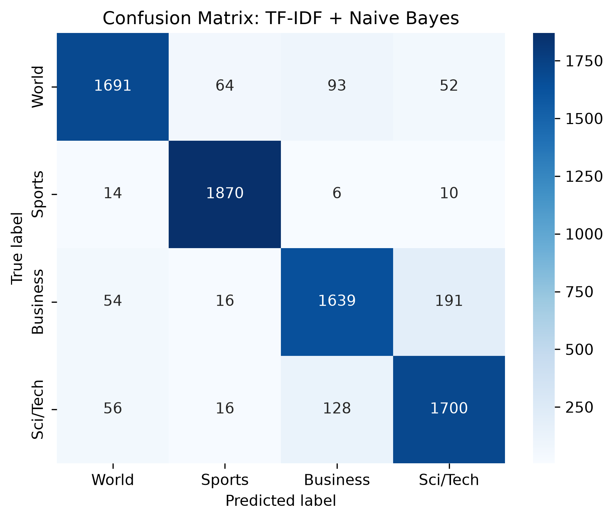
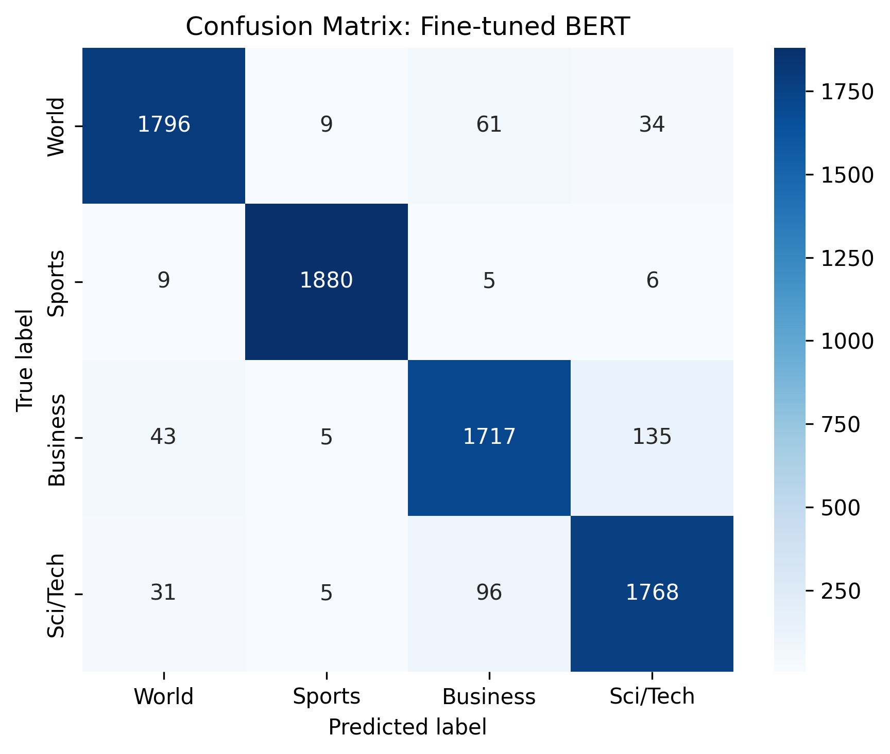
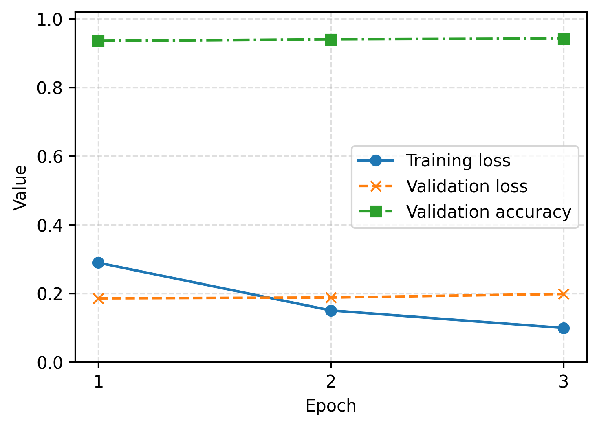
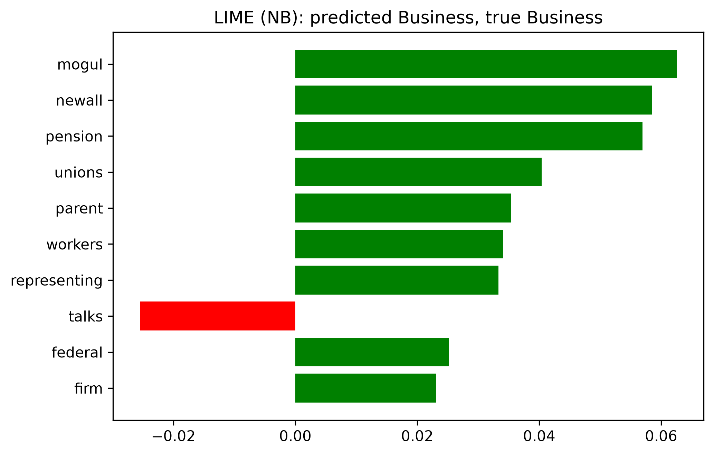
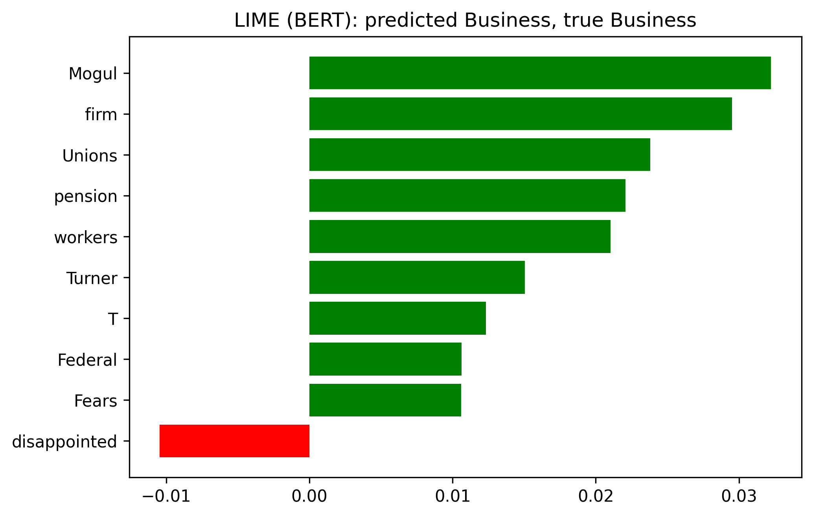

# Explainable News Classification with TF-IDF, Naive Bayes and Fine-tuned BERT

This repository studies topic classification of news articles on the AG News benchmark and examines *why* the classifiers make their decisions. We compare a sparse lexical baseline (TF-IDF with Multinomial Naive Bayes) against a fine-tuned transformer (`bert-base-uncased`), and we use LIME to produce local, word-level explanations for individual predictions of both models.

## Contents

1. [Dataset](#dataset)
2. [Method](#method)
3. [Results](#results)
4. [Explainability](#explainability)
5. [Repository structure](#repository-structure)
6. [Installation](#installation)
7. [Reproducing the experiments](#reproducing-the-experiments)
8. [Limitations](#limitations)
9. [References](#references)

## Dataset

We use AG News (Zhang et al., 2015) as distributed on the Hugging Face Hub (`fancyzhx/ag_news`). Each record is the headline and short description of a news article, labelled with one of four topics.

| Split | Articles | Source |
|---|---:|---|
| Train | 108,000 | Official training split minus validation |
| Validation | 12,000 | Stratified 10% of the official training split (seed 42) |
| Test | 7,600 | Official test split, used once per model |

All four classes (World, Sports, Business, Sci/Tech) are equally represented in every split. The test split is never used for model selection.

## Method

**Text normalisation.** Raw descriptions contain escaped HTML entities (`#39;`, `quot;`) and news-agency bylines such as `(Reuters)` or `AFP -`. A byline identifies the source of an article, not its topic, and 19.7% of training articles contain one. We remove both so that neither model can rely on them as shortcuts. Two views of each article are stored:

* `text` keeps casing and punctuation and is the input to BERT;
* `clean_text` is lower-cased and restricted to alphabetic tokens and is the input to TF-IDF.

**Baseline.** TF-IDF over unigrams and bigrams (sublinear term frequency, minimum document frequency 2) followed by Multinomial Naive Bayes. The smoothing parameter alpha is chosen from {0.01, 0.03, 0.1, 0.3, 1.0} on the validation split; the selected model is refit on train and validation before testing.

**BERT.** `bert-base-uncased` with a linear classification head, fine-tuned for 3 epochs with AdamW (learning rate 2e-5, weight decay 0.01, 6% linear warm-up), batch size 32, maximum sequence length 128 and mixed precision on a single NVIDIA T4 GPU. We keep the checkpoint with the highest validation accuracy and evaluate it once on the test split.

**Explanations.** LIME (Ribeiro et al., 2016) perturbs an article by removing words, queries the model on 5,000 perturbed copies and fits a sparse linear surrogate. The surrogate weights indicate how strongly each word supports or opposes the predicted class. We always explain the class the model actually predicts.

## Results

Test-set performance on the 7,600 official AG News test articles:

| Model | Accuracy | Macro-F1 |
|---|---:|---:|
| TF-IDF (1-2 grams) + Multinomial Naive Bayes (alpha = 0.03) | 90.79% | 90.77% |
| Fine-tuned `bert-base-uncased` | **94.22%** | **94.23%** |

Fine-tuning BERT reduces the number of misclassified test articles from 700 to 439, a relative error reduction of 37%.

Per-class F1 scores:

| Class | Naive Bayes | BERT |
|---|---:|---:|
| World | 91.04% | 95.05% |
| Sports | 96.74% | 98.97% |
| Business | 87.04% | 90.87% |
| Sci/Tech | 88.24% | 92.01% |

<p align="center">
  
  
</p>

Both models separate Sports almost perfectly. The dominant source of error for both is the Business and Sci/Tech pair, which is consistent with the shared vocabulary of technology companies, markets and earnings reports. BERT lowers these confusions from 191 to 135 (Business predicted as Sci/Tech) and from 128 to 96 (Sci/Tech predicted as Business), yet they remain its largest error category.

**BERT training dynamics.** Validation accuracy rises from 93.56% after the first epoch to 94.01% and 94.23% after the second and third. Training loss falls from 0.289 to 0.099, while validation loss increases slightly (0.185, 0.188, 0.198), an early sign of overfitting that a longer schedule would amplify. Checkpoint selection on validation accuracy retains the third epoch. Fine-tuning took 25 minutes on a single T4 GPU.

<p align="center">
  
</p>

Full metrics, including confusion matrices and validation scores, are stored as JSON in [`results/metrics/`](results/metrics).

## Explainability

We compare the two models on the first test article, a Business story on a pension dispute at Turner & Newall. Both predict Business with probability 0.998.

| Rank | Naive Bayes | Weight | BERT | Weight |
|---:|---|---:|---|---:|
| 1 | mogul | +0.063 | Mogul | +0.032 |
| 2 | newall | +0.058 | firm | +0.030 |
| 3 | pension | +0.057 | Unions | +0.024 |
| 4 | unions | +0.040 | pension | +0.022 |
| 5 | parent | +0.035 | workers | +0.021 |

The two models rely on overlapping evidence: *pension*, *unions* and *workers* appear among the strongest cues for both. BERT spreads its attribution more evenly and gives more weight to generic business vocabulary such as *firm*. Both models, however, also draw on company names (*Mogul*, *Newall*, *Turner*), which are specific to the training corpus and would not transfer to unseen entities. The lexical baseline counts *talks* against the class, whereas BERT counts *disappointed* against it.

<p align="center">
  
  
</p>

Each explanation is saved as a static PNG and as an interactive HTML page in [`results/figures/`](results/figures).

## Repository structure

```
explainable-news-classification/
├── notebooks/
│   ├── 01_exploration.ipynb      # data download, class balance, length statistics, cleaning
│   ├── 02_naive_bayes.ipynb      # baseline training, evaluation and LIME
│   └── 03_bert_finetune.ipynb    # BERT fine-tuning, evaluation and LIME (Colab, GPU)
├── src/
│   ├── config.py                 # paths, labels and hyperparameters
│   ├── download_data.py          # fetches the official AG News splits
│   ├── preprocess.py             # normalisation and train/validation/test files
│   ├── train_naive_bayes.py      # TF-IDF + Naive Bayes with validation-based alpha selection
│   ├── train_bert.py             # BERT fine-tuning and test evaluation
│   ├── explain_model.py          # LIME explanations for either model
│   └── utils.py                  # metrics and plotting
├── results/
│   ├── figures/                  # confusion matrices, training curve, LIME outputs, EDA plots
│   └── metrics/                  # JSON metrics for each model
├── tests/                        # unit tests for preprocessing and label mapping
├── requirements.txt
├── requirements-dev.txt
└── LICENSE
```

Raw and processed data (`data/`) and trained model weights (`results/models/`) are not versioned; the scripts below recreate them.

## Installation

Python 3.10 or newer is required. The experiments were run with Python 3.12 (CPU) and Python 3.13 (Google Colab, T4 GPU).

```bash
git clone https://github.com/EmpireNetwork123/explainable-news-classification.git
cd explainable-news-classification
python -m venv .venv
source .venv/bin/activate        # Windows: .venv\Scripts\activate
pip install -r requirements.txt
```

For running the tests and executing notebooks, install `requirements-dev.txt` instead.

## Reproducing the experiments

All commands are run from the repository root.

```bash
python -m src.download_data          # 1. fetch AG News into data/raw/
python -m src.preprocess             # 2. normalise text and create train/val/test files
python -m src.train_naive_bayes      # 3. baseline: about 1 minute on a laptop CPU
python -m src.explain_model --model nb --index 0
python -m src.train_bert             # 4. BERT: requires a GPU (about 25 minutes on a T4)
python -m src.explain_model --model bert --index 0
```

`src.train_bert` accepts `--max-train-samples`, `--max-eval-samples` and `--epochs` for a quick functional check on CPU. Runs with a reduced training set write their outputs with a `_subset` suffix so they cannot overwrite the reported results.

To fine-tune BERT without a local GPU, open [`notebooks/03_bert_finetune.ipynb`](notebooks/03_bert_finetune.ipynb) in Google Colab [](https://colab.research.google.com/github/EmpireNetwork123/explainable-news-classification/blob/main/notebooks/03_bert_finetune.ipynb), select *Runtime > Change runtime type > T4 GPU* and run all cells.

Unit tests:

```bash
pip install -r requirements-dev.txt
pytest
```

## Limitations

* LIME explanations are local and depend on random perturbations; they describe the behaviour of one model on one article and should not be read as global feature importance.
* AG News articles are short and drawn from a single collection period (2004 to 2005), so the reported accuracy does not necessarily carry over to current news or longer documents.
* Removing agency bylines makes the task slightly harder than the commonly reported setting. Results are therefore not strictly comparable with published numbers obtained on unnormalised text.

## References

* Devlin, J., Chang, M.-W., Lee, K., & Toutanova, K. (2019). BERT: Pre-training of Deep Bidirectional Transformers for Language Understanding. *NAACL-HLT*.
* Ribeiro, M. T., Singh, S., & Guestrin, C. (2016). "Why Should I Trust You?": Explaining the Predictions of Any Classifier. *KDD*.
* Zhang, X., Zhao, J., & LeCun, Y. (2015). Character-level Convolutional Networks for Text Classification. *NeurIPS*.

## License

Released under the [MIT License](LICENSE).
