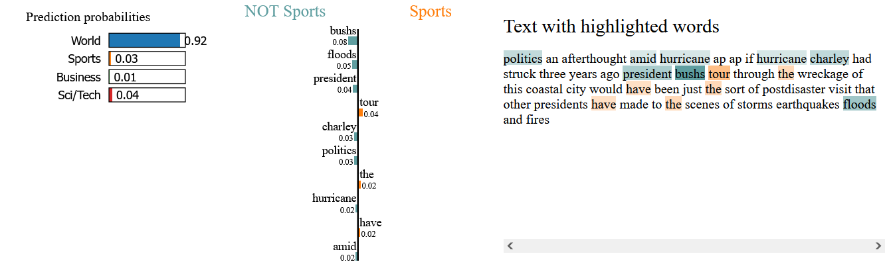

<p align="center">
  
</p>

# 📰 Explainable News Classification Using Hybrid NLP & BERT Fine-Tuning

This project explores explainable text classification of news articles using both traditional Natural Language Processing (NLP) methods and fine-tuned BERT. The model classifies news articles into categories such as World, Sports, Business, and Science/Technology — with interpretable insights via LIME.

---

## 📌 Project Overview

- Built a **news classification pipeline** using both **TF-IDF + Naïve Bayes** and **fine-tuned BERT**.
- Emphasized **explainability** using **LIME** (Local Interpretable Model-Agnostic Explanations).
- Compared model performance using metrics like accuracy, loss, and confusion matrix.
- Structured in a modular way to support experimentation, reproducibility, and documentation.

---

## 🛠️ Installation

To run this project locally, clone the repository and install dependencies:

```bash
git clone https://github.com/EmpireNetwork123/explainable-news-classification.git
cd explainable-news-classification
pip install -r requirements.txt
